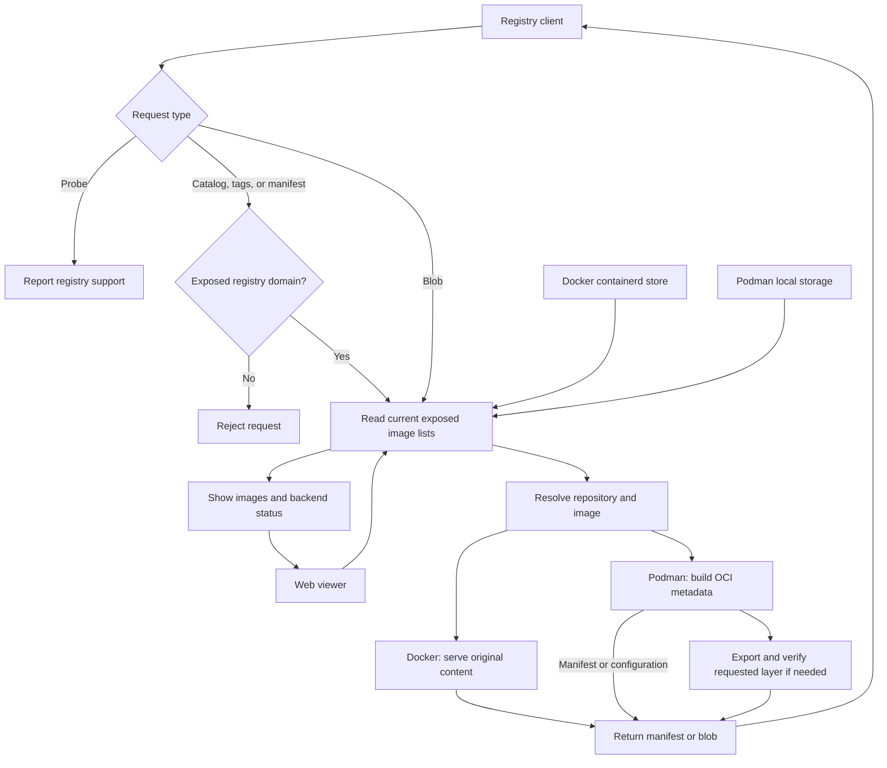

# regview

regview lets other machines pull images from your local Docker and Podman stores
through a read-only OCI/Docker registry. A separate web viewer shows the available
images and backend status. It never fetches images from an upstream registry or
pushes, deletes, or retags your images.

It runs on Linux. Docker needs the containerd image store; Podman reads its local
storage directly and does not need an API service. Run regview as the user who
owns the images, or as root for system stores.

## Quick start and configuration

Building requires Go 1.27.3+, Node.js 22.18+, pnpm 12.15.0, and
[just](https://just.systems). From this checkout:

```sh
just build
./bin/regview --hostnames localhost:5000
```

The registry listens at `127.0.0.1:5000`. Open
[the web viewer](http://127.0.0.1:8080) to browse images.
Both endpoints use HTTP, with no authentication or TLS. Keep them on a trusted
network, or put them behind a proxy that provides access control and TLS.

regview discovers usable local Docker and Podman stores at startup. To use only
one, add `--backends docker` or `--backends podman`. Explicitly selected backends
must be available; discovery skips unavailable ones. Rootless Podman may need
`newuidmap`, `newgidmap`, and subordinate UID/GID mappings.

### Expose an image

The registry domain in an image reference must match an allowed domain, including
its optional port. The `--hostnames` option configures these registry domains.
For example, tag an existing Docker image and inspect it through regview:

```sh
docker tag your-image:latest localhost:5000/team/app:v1
curl http://localhost:5000/v2/team/app/tags/list
```

Use `podman tag` instead for a Podman image. A registry client can pull
`localhost:5000/team/app:v1` once it is configured to allow HTTP for that registry.
For another machine, use a hostname that resolves to the regview server in both
the image reference and `--hostnames`, and set `--registry-listen` to an address the
client can reach, such as `0.0.0.0:5000`.

You can also expose existing image names:

```sh
./bin/regview --hostnames docker.io,quay.io
curl -H 'Host: quay.io' http://127.0.0.1:5000/v2/_catalog
```

A normal client must route that registry domain to regview while preserving
its HTTP `Host` header for repository listings, tags, and manifests. Forwarded
host headers are ignored. Registry domains are exact:
`docker.io` and `registry-1.docker.io` are different. Short image names such as
`alpine:latest` expand to `docker.io/library/alpine:latest`.

The web viewer shows images across all configured registry domains. Registry
clients see only repositories and tags under the requested registry domain.

Blob downloads can use any hostname that reaches regview. A requested layer or
configuration digest must belong to an exposed image in the repository named
in the URL. Knowing a digest does not grant access to content belonging only to
unexposed images or other repositories. The `/v2/` probe also accepts any hostname.

### Save your settings

Copy [regview.example.yaml](regview.example.yaml), adjust it, and run:

```sh
./bin/regview --config regview.yaml --dry-run
./bin/regview --config regview.yaml
```

`--dry-run` checks and prints settings without opening stores or starting servers.
It does not check backend availability. Without `--config`, regview looks for
`regview.yaml` in `$XDG_CONFIG_HOME/regview` (usually `~/.config/regview`),
or `/etc/regview` when running as root.

Settings take precedence in this order: command-line flags, environment
variables, configuration file, defaults. Environment variables start with
`REGVIEW_`, with hyphens replaced by underscores:

```sh
REGVIEW_BACKENDS=podman REGVIEW_HOSTNAMES=quay.io ./bin/regview
```

Use `./bin/regview --help` for all options. Common overrides are:

| Setting | Purpose |
| --- | --- |
| `--registry-listen`, `--admin-listen` | Change the registry and viewer listen addresses. |
| `--docker-engine-socket` | Use a different local Docker engine socket. Docker CLI contexts are not selected automatically. |
| `--docker-socket`, `--docker-namespace` | Connect directly to Docker's containerd instance, bypassing engine discovery. |
| `--podman-graphroot`, `--podman-runroot`, `--podman-driver` | Override Podman's storage settings. Usually its existing `storage.conf` is enough. |
| `--podman-blob-cache-ttl` | Reuse verified Podman layer readers for this long (default `2m`; `0` disables reuse). |
| `--podman-blob-cache-max-bytes`, `--podman-blob-cache-max-entries` | Limit retained readers (default 1 GiB and 64 entries). |

Run `./bin/regview licenses` to read the third-party notices included in the binary.

## How it works

Registry listings, image lookups, and viewer refreshes read the current local
image list. For `quay.io/team/app:v1`, the registry domain is `quay.io`, the
repository path is `team/app`, and the tag is `v1`. A registry domain includes
an optional port, as in `localhost:5000`. The full repository name is
`quay.io/team/app`; adding the tag produces an image reference.
Images are grouped by registry domain, repository path, and tag. If Docker
and Podman contain different images under the same tag, Docker wins; the viewer
shows the conflict. Manifest lookups, including by digest, stay within the
requested registry domain and repository path. Blob lookups search that
repository path across all exposed domains.



Docker content keeps its original bytes and digests. Podman images are presented
as OCI images with uncompressed layers, so their manifest digests usually change.
Original digests are never used for changed content. Signatures tied to the
original manifest are not preserved as verified metadata.

Podman layer downloads are verified before serving. Verified readers are briefly
reused to avoid exporting the same layer repeatedly; this can retain temporary
disk space and open files. Image lists and generated manifests are never cached.
HEAD and conditional requests normally use metadata alone, though a layer with
an unknown size must first be measured. Downloads support HTTP ranges.

OCI and Docker schema-2 manifests and indexes are supported. Docker indexes keep
references to missing local images; those images cannot be downloaded. Podman
indexes include only locally available images. Legacy schema-1 images and the
referrers/signature API are not supported.
